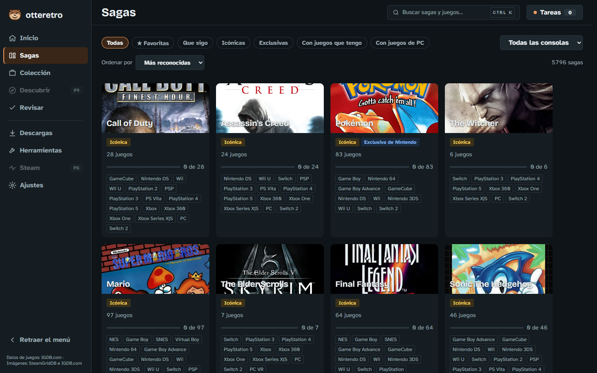
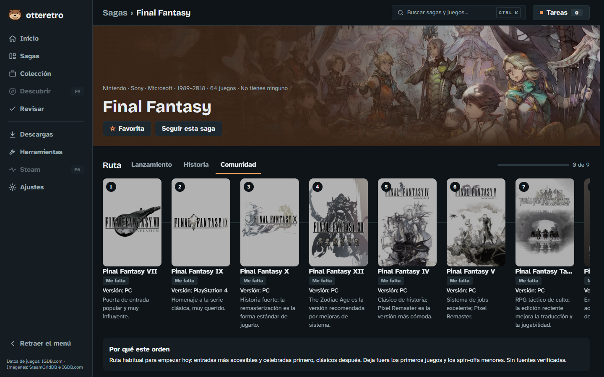
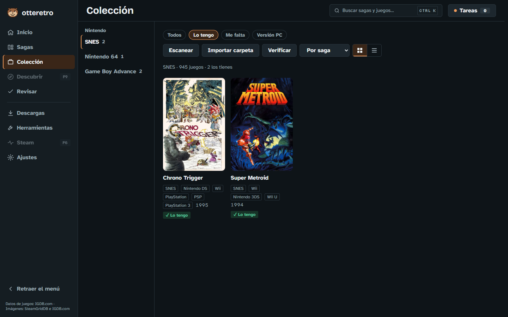
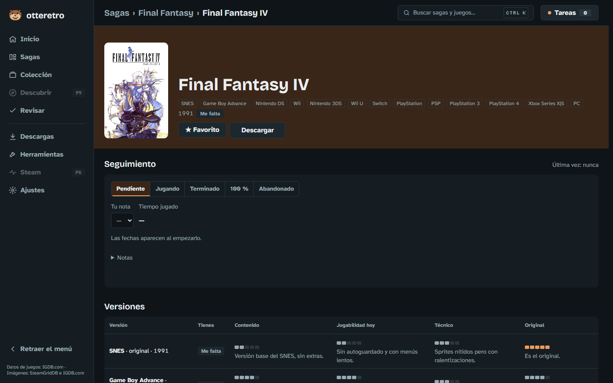

<p align="center">
  
</p>

<h1 align="center">Otteretro</h1>

<p align="center">
  <b>Ordena tu colección. Recorre tus sagas.</b>
</p>

<p align="center">
  Para quien tiene juegos, ROMs y emuladores repartidos en varios discos y está cansado de ordenarlos a mano.<br>
  Otteretro los encuentra, los reconoce y los deja en su lugar, y además te dice por dónde empezar cada saga.
</p>

<p align="center">
  <a href="#instalar">Instalar</a> ·
  <a href="#el-recorrido">El recorrido</a> ·
  <a href="#el-catálogo-es-de-todos">El catálogo</a> ·
  <a href="docs/README.md">Documentación</a>
</p>



## Menos tiempo ordenando, más tiempo jugando

Si emulas, conoces la rutina: carpetas con nombres a medias, el mismo juego en tres discos, versiones que no sabes si están completas y un rato largo cada vez que llega algo nuevo. Y cuando por fin está todo en orden, queda la otra pregunta: *¿por cuál Final Fantasy empiezo?*

Otteretro se encarga de las dos cosas. Revisa tus discos y te muestra lo que tienes, ordena solo lo que va llegando y trae un catálogo de casi 5.800 sagas con rutas para recorrerlas. No reemplaza a tus emuladores ni a Steam: les deja la colección en orden.

## El recorrido

### 1 · Descubre por dónde empezar



Cada saga muestra sus juegos en orden, con las consolas donde salieron y los que ya tienes. Las más conocidas traen **rutas**: por fecha de lanzamiento, por orden de la historia o la que recomienda la comunidad, con la versión sugerida en cada paso y el porqué. Sigues una y Otteretro te va diciendo cuál es el siguiente.

### 2 · Mira lo que ya tienes



Le dices en qué discos están tus juegos y Otteretro los busca, los reconoce por su nombre o por su contenido y los marca como «lo tengo». Puedes comprobar que cada archivo esté sano comparándolo con las bases de datos de preservación, sin conexión. Si conectas tu cuenta de Steam, lo que compraste ahí también cuenta, con tus horas.

### 3 · Deja que se ordene solo

Cada disco tiene una carpeta `Entrada`: lo que dejas ahí se descomprime, se reconoce, pasa al formato que menos espacio ocupa y queda en su carpeta, `Juegos\<Consola>\<Juego>`. Lo mismo al importar una carpeta entera o al terminar una descarga. Lo que Otteretro no reconoce con seguridad espera a que lo revises, y Claude puede proponerte qué juego es (opcional).

**No pierdes archivos.** Mover siempre es copiar, verificar y recién entonces borrar. Quitar un juego lo manda a la papelera.

### 4 · Lleva el registro de lo que juegas



Cada juego tiene su ficha: estado (pendiente, jugando, terminado, 100 %, abandonado), tu nota, tus apuntes y sus versiones lado a lado, para elegir cuál jugar. Las horas de Steam llegan solas.

### 5 · Y después, jugar

Lanzar cada juego con su emulador desde Otteretro y llevarlo a Steam ordenado por saga es lo siguiente del plan. Hoy, Otteretro ordena y tus emuladores juegan.

## Instalar

1. Descarga `Otteretro-win-Setup.exe` desde la [última versión](https://github.com/OscarVargas97/otteretro/releases/latest).
2. Ábrelo. El asistente te pide dónde guardar los datos de Otteretro y en qué discos están tus juegos. Si ya tenías una carpeta de juegos, la encuentra y te ofrece adoptarla.
3. Listo: las sagas y las rutas ya vienen adentro, y las portadas se bajan solas a medida que las ves.

Otteretro se actualiza solo. En **Ajustes › General › Actualizaciones** puedes pasar al canal **Pruebas** para ver lo nuevo antes que nadie.

### Qué necesitas

**Nada para empezar.** El catálogo, las rutas, el seguimiento, la colección y el orden de tus archivos funcionan sin cuentas ni claves. Lo demás es opcional y se configura en **Ajustes › Cuentas y claves**:

| Para | Necesitas |
|---|---|
| Sumar tus juegos y horas de Steam | Una clave gratuita de la [Steam Web API](https://steamcommunity.com/dev/apikey) |
| Reconocer más archivos | Tu cuenta de [ScreenScraper](https://www.screenscraper.fr) |
| Que Claude proponga lo que nada reconoció | [Claude Code](https://claude.com/claude-code) instalado, con tu suscripción |
| Bajar tus juegos desde donde los guardaste | Tu cuenta de ese servicio, si la pide |

**Otteretro no trae juegos, BIOS, keys ni firmware**, ni te dice de dónde sacarlos.

### Plataformas

- **Windows:** con instalador y actualizaciones automáticas. Es donde se usa y se prueba hoy.
- **Linux:** existe un paquete de Nix pensado para [PlayOS](https://github.com/OscarVargas97/playos), una distribución para jugar basada en NixOS. El soporte completo de Linux es la última fase del plan.

Interfaz en español e inglés.

## El catálogo es de todos

Las sagas, los juegos, las rutas y las portadas no los arma cada instalación: vienen hechos, desde [otteretro-catalogo](https://github.com/OscarVargas97/otteretro-catalogo), un proyecto hermano y abierto. Hoy son **5.795 sagas y 49.655 juegos** de Nintendo, Sony, Microsoft y PC, con **111 rutas**, y crece con cada aporte.

Cada saga es un archivo que cualquiera puede corregir: una ruta que falta, un juego mal ubicado, una versión mejor. Así se [propone un cambio](https://github.com/OscarVargas97/otteretro-catalogo/blob/main/CONTRIBUTING.md).

Cuando hay una versión nueva del catálogo, la eliges tú en **Ajustes › Catálogo**: ves qué cambia y qué toca de tus datos antes de aceptarla. Tu colección y tu progreso nunca se pierden.

## Tus datos

| Qué | Dónde |
|---|---|
| Tu colección, tu progreso, tus notas y tus enlaces | En tu equipo, en la carpeta que elegiste. No se publican |
| El catálogo | Un archivo aparte, sin nada tuyo |
| Tus claves y cuentas | Cifradas por el sistema (DPAPI en Windows, el llavero en Linux). No pasan de un equipo a otro |
| Respaldo | Todavía no existe: está en la hoja de ruta |

Otteretro se conecta a GitHub (actualizaciones y catálogo), a las fuentes de portadas y de bases de preservación, y a los servicios que configures. Cuando Claude ayuda a reconocer un archivo, recibe su nombre, su carpeta y su consola, a través de tu Claude Code.

## Aviso legal

Otteretro es para **tus propios juegos**. El gestor de descargas sirve para bajar lo que ya es tuyo y guardaste en servicios de terceros, desde enlaces que tú le das: nunca busca de dónde sacar un juego. Este proyecto no promueve la piratería ni ofrece contenido protegido. Respeta las leyes de tu país y los términos de cada servicio que uses.

## Estado

Otteretro está en **acceso anticipado**: lo de arriba funciona, y cada fase nueva llega primero al canal Pruebas. Algunas conexiones todavía no se probaron con cuentas reales, como ScreenScraper y varios sitios de descarga. Si algo falla, abre un [issue](https://github.com/OscarVargas97/otteretro/issues).

**Lo que viene:**

1. Emuladores y ports instalados y al día desde Otteretro.
2. Jugar desde Otteretro y llevar tus juegos a Steam, por saga.
3. Respaldo de tus datos y partidas en un repositorio privado tuyo.
4. Tus tiendas de PC, precios y ofertas.
5. Descubrir sagas nuevas según lo que te gusta.
6. Linux y PlayOS.

Lo que trae cada versión está en el [CHANGELOG](CHANGELOG.md), y el plan, en los [milestones](https://github.com/OscarVargas97/otteretro/milestones).

## Desarrollar

C# (.NET 10, ASP.NET Core y SQLite) con una interfaz Next.js, en una ventana Photino, empaquetado con Velopack.

```powershell
dotnet test                       # pruebas
npm --prefix web run e2e          # pruebas de interfaz
./scripts/empaquetar.ps1          # instalador local
```

Empieza por [`AGENTS.md`](AGENTS.md). Los requisitos están en [`docs/REQUISITOS.md`](docs/REQUISITOS.md), la arquitectura en [`docs/arquitectura.md`](docs/arquitectura.md) y el resto, en el [índice de la documentación](docs/README.md).

## Créditos y licencia

- Datos de juegos: [IGDB.com](https://www.igdb.com). Imágenes: [SteamGridDB](https://www.steamgriddb.com) e IGDB.
- Bases de preservación: [No-Intro](https://no-intro.org), vía [libretro-database](https://github.com/libretro/libretro-database), y [Redump](http://redump.org).
- [DolphinTool](https://dolphin-emu.org) y [chdman](https://www.mamedev.org) van incluidos con sus licencias, en `src/Otteretro/herramientas`.

Otteretro se publica bajo la licencia [GPL-3.0](LICENSE). Los nombres y marcas de los juegos pertenecen a sus dueños.
