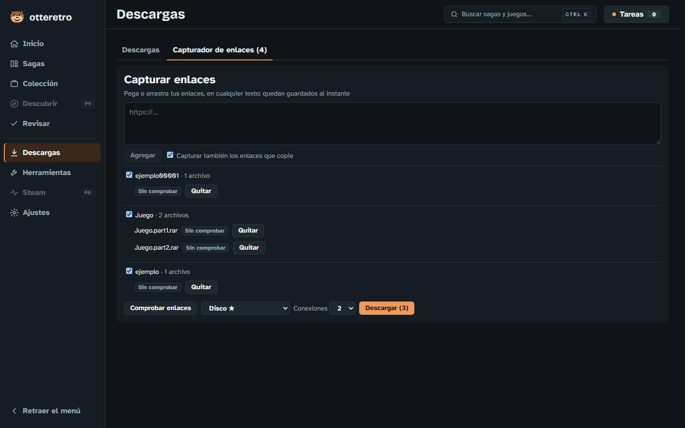
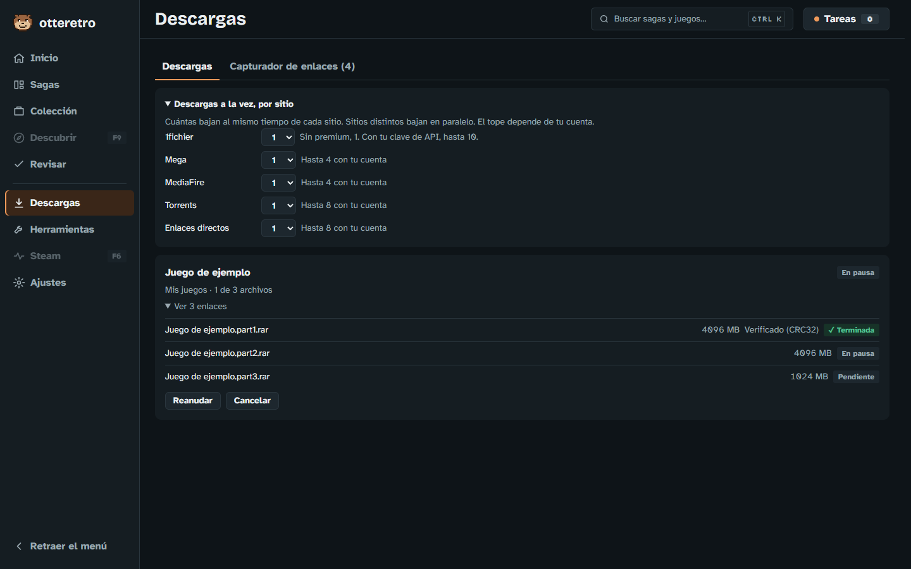
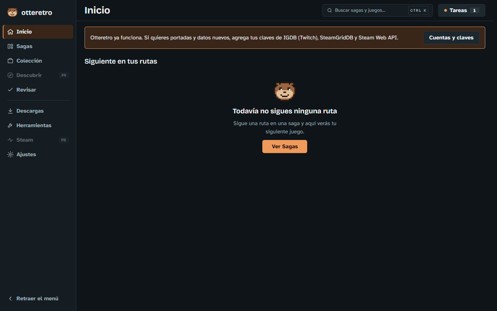

<p align="center"></p>

<h1 align="center">Otteretro</h1>

<p align="center"><b>Tu colección de videojuegos, ordenada por sagas.</b><br>Qué jugar y en qué orden, qué ya tienes, y tus archivos ordenados solos en tus discos.</p>


> **Estado:** en desarrollo activo, para uso personal. Funciona en Windows; Linux llega al final del plan. Algunas funciones aún no se han probado con cuentas reales: están marcadas abajo.

## Qué hace

- **Sagas y rutas.** Trae un catálogo con casi 5.800 sagas y 50.000 juegos, listo desde el primer minuto. Cada saga puede tener rutas de lanzamiento, de historia y recomendada.
- **Tu colección.** Busca tus juegos en tus discos, los reconoce por nombre o por hash contra Redump y otros DAT, y te muestra qué tienes y qué te falta.
- **Tus archivos en orden.** Importas una carpeta o dejas los juegos en `Entrada` de un disco: se descomprimen, se reconocen, se pasan a RVZ o CHD y quedan en su lugar. Nada se borra hasta verificar la copia.
- **Descargas, como un JDownloader integrado.** Capturador de enlaces, paquetes, pausa, torrents y descargas a la vez por sitio. Comprueba el tamaño y los hashes de lo que baja.
- **Seguimiento.** Estado, nota, horas y notas por juego.

## Capturas

| | |
|---|---|
|  |  |
| **Una saga**, con su ruta paso a paso y por qué ese orden | **La ficha de un juego**, con su seguimiento y sus versiones |
|  |  |
| **Tu colección**, por consola | **El capturador de enlaces**: lo que pegas o copias queda guardado |
|  |  |
| **Las descargas**, con cómo va y cómo se verificó cada archivo | **Inicio**: tu siguiente juego |

Las capturas salen de una instalación limpia con una biblioteca y descargas de ejemplo. Se ven sin portadas porque así queda la app hasta que pones tu clave de SteamGridDB, que es gratis.

## Instalar

1. Descarga `Otteretro-win-Setup.exe` desde [Releases](https://github.com/OscarVargas97/otteretro/releases/latest).
2. Ábrelo y elige dónde guardar tus datos.
3. Listo: el catálogo ya está adentro.

La app y su catálogo se actualizan solos. En **Ajustes › General** puedes pasar al canal **Pruebas** para ver lo más nuevo antes de que se publique.

> Las funciones de la fase actual (importar, descargas, capturador) llegan a **Estable** cuando la fase termina. Antes de eso, están en el canal Pruebas.

## Qué necesitas

**Nada para empezar.** Sagas, juegos, rutas, seguimiento, colección, importar y las actualizaciones del catálogo funcionan sin ninguna cuenta. Lo demás es opcional, y se configura en **Ajustes › Cuentas y claves**:

| Para | Necesitas | Costo |
|---|---|---|
| Portadas e imágenes | Clave de [SteamGridDB](https://www.steamgriddb.com/profile/preferences/api) | Gratis |
| Tus juegos y horas de Steam | Clave de la [Steam Web API](https://steamcommunity.com/dev/apikey) | Gratis |
| Bajar con tu cuenta de 1fichier o Mega | Tu cuenta | Depende del sitio |
| Que Claude identifique los archivos que no se reconocen | [Claude Code](https://claude.com/claude-code) con tu suscripción | Tu suscripción |

**Otteretro no trae juegos, BIOS, keys ni firmware**, ni te dice de dónde sacarlos. Los archivos son tuyos.

## El catálogo

Las sagas, los juegos y las rutas se publican aparte, en [otteretro-catalogo](https://github.com/OscarVargas97/otteretro-catalogo): un archivo por saga, que cualquiera puede corregir con un PR. Otteretro baja la última versión al abrir.

## Tu privacidad

Tus datos viven en tu equipo, en la carpeta que elegiste. El catálogo que trae la app es de todos, y va en un archivo aparte: nada de lo tuyo (lo que tienes, lo que jugaste, tus notas, tus enlaces o tus claves) sale de tu equipo ni se publica.

## Lo que todavía no está probado de verdad

- Mega y MediaFire, con enlaces reales.
- Torrents de internet: solo se probaron entre dos clientes en un mismo equipo.
- ScreenScraper, con cuentas reales.

Si algo falla, abre un [issue](https://github.com/OscarVargas97/otteretro/issues).

## Para desarrollar

C# (ASP.NET Core y SQLite) y Next.js, en una ventana Photino, empaquetado con Velopack.

```powershell
dotnet test                       # pruebas
npm --prefix web run e2e          # pruebas de interfaz
./scripts/empaquetar.ps1          # instalador local
```

Instrucciones en [`AGENTS.md`](AGENTS.md), requisitos en [`docs/REQUISITOS.md`](docs/REQUISITOS.md) y arquitectura en [`docs/arquitectura.md`](docs/arquitectura.md). La documentación está en español.

## Créditos y licencia

- Datos de juegos: [IGDB.com](https://www.igdb.com).
- Hashes de juegos: [Redump](http://redump.org) y otros proyectos de preservación.
- [DolphinTool](https://dolphin-emu.org) y [chdman](https://www.mamedev.org) van incluidos con sus licencias, en `src/Otteretro/herramientas`.

El código de Otteretro se publica bajo la licencia [GPL-3.0](LICENSE). Los nombres y marcas de los juegos pertenecen a sus dueños.
